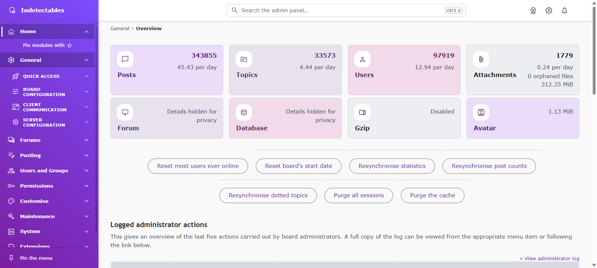

# Modern Admin Panel for phpBB

**The public, free edition of Modern Admin Panel for phpBB 3.3.** A responsive ACP with sidebar navigation, command search, colour themes, and dashboard widgets. Ready to install; no asset build or Node.js required.



*Real installation; private server details hidden. See [compact navigation](docs/FEATURES.md#sidebar), [command search](docs/FEATURES.md#command-palette), and [dark mode](docs/FEATURES.md#colour-mode).*

## Highlights

- **Responsive navigation:** full sidebar, compact icon rail with flyouts, and a mobile drawer.
- **Command search:** `Ctrl/Cmd+K` finds modules, settings, forums, groups, users, and permitted maintenance links.
- **Personal shortcuts:** up to 12 favourites and 8 recent modules, stored in each administrator's browser without session URLs.
- **Flexible dashboard:** pending work, statistics, shared notes, Quick access, logs, and inactive users.
- **Consistent themes:** 20 colour presets, light/dark/system modes, and three menu shapes across ACP forms and tables.
- **Accessible and self-contained:** keyboard controls, RTL, reduced motion, English/Spanish, and bundled assets without a CDN.
- **Extension icons:** curated mappings for 30 public extensions plus DSR modules. See [coverage and limits](docs/menu-extension-icons.md).

## Requirements

- phpBB 3.3.x, tested on 3.3.19. Metadata allows 4.0.x, but compatibility is unverified.
- PHP 7.1.3 or later, subject to phpBB's requirements; phpBB 4.x requires PHP 8.2 or later.
- JavaScript for interactive features. Without it, basic navigation and settings search remain available.

## Install

1. Download the installable ZIP from [Releases](https://github.com/xchwarze/phpbb-modern-admin-panel/releases), or copy the repository's `dsr/modernadminpanel/` directory into your board's `ext/dsr/modernadminpanel/`.
2. In the ACP, open **Customise → Extension management → Manage extensions** and enable **Modern Admin Panel**.
3. Configure **Extensions → Modern Admin Panel → Settings**.

Modern Admin Panel is a separate extension from `phpbbstudio/admindashboard`; do not enable both together. See the [replacement instructions](docs/README.md#replace-phpbbstudioadmindashboard) if that extension is installed.

## Paid modules and custom work

These are separate paid products and services, not included in this public edition. No Modern Admin Panel feature requires them.

- **OAuth Register:** sign-in and registration through external identity providers.
- **Spam Guard:** manual filters and AI-assisted spam detection.
- **Async Notifications:** background notification processing for large forums.
- **Push Notifications:** push alerts for forum users.
- **Android and iOS apps:** mobile apps integrated with your forum.
- **Custom extensions:** phpBB features tailored to your community.

Contact **DSR!** at [xchwarze@gmail.com](mailto:xchwarze@gmail.com) for availability, pricing, and custom requests.

## Documentation

- [Installation, updates, privacy, and credits](docs/README.md)
- [Features and settings](docs/FEATURES.md)
- [Curated extension icon coverage](docs/menu-extension-icons.md)
- [Version history](docs/CHANGELOG.md)
- [Extension events and palette endpoint](docs/EVENTS.txt)

## Repository layout

```text
README.md                 Product overview and installation
docs/                     User guide, features, changelog and integration notes
dsr/modernadminpanel/      Complete installable extension, including CSS and JavaScript
```

This repository distributes the public extension, not its private authoring project. Install the supplied runtime; no `src/` directory or npm build is needed.

## Support

Report bugs in [GitHub Issues](https://github.com/xchwarze/phpbb-modern-admin-panel/issues). Include phpBB/PHP versions, browser, related extensions, and reproduction steps. Never post credentials, session URLs, or private board data.

## Credits and licence

An independent rewrite of phpBB Studio’s Admin Dashboard 1.1.0, not its upgrade. See [credits](docs/README.md#credits-and-licence).

Modern Admin Panel is licensed under [GPL-2.0-only](LICENSE). Material Symbols retain their [Apache-2.0 licence and attribution](dsr/modernadminpanel/adm/style/images/ICONS-LICENSE.txt).
