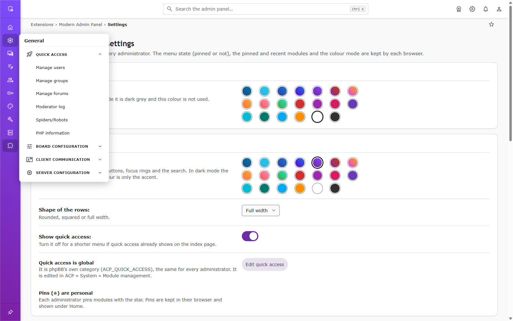
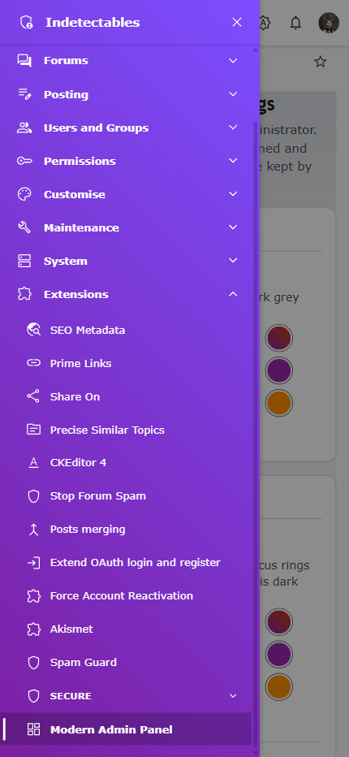
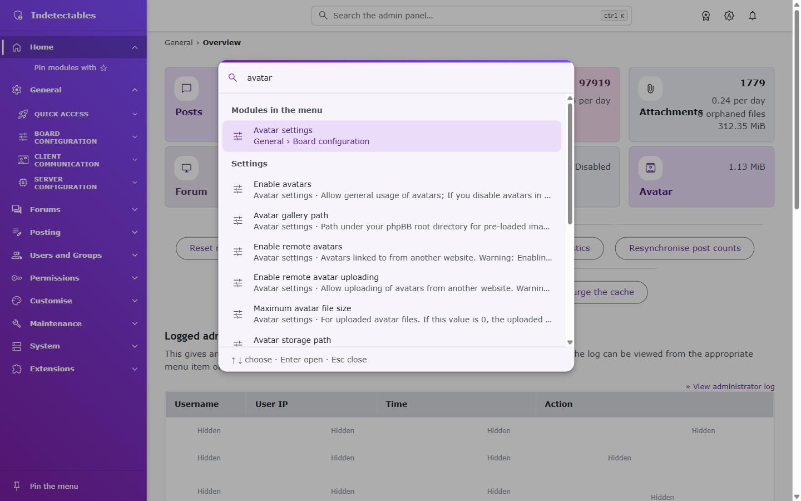
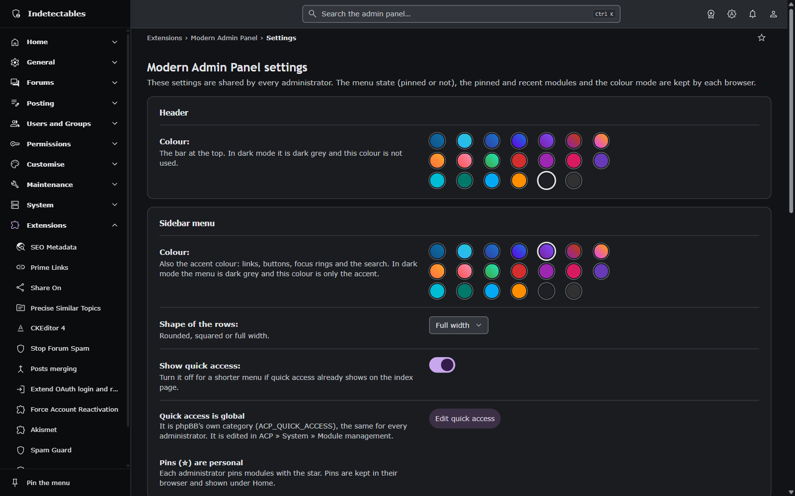

# Modern Admin Panel: features

Features of public version 2.0.0. Board-wide options live under
`Extensions » Modern Admin Panel » Settings`. All features below are included;
[paid modules](../README.md#paid-modules-and-custom-work) are separate products.

## Contents
- [Sidebar](#sidebar)
- [Header and search box](#header-and-search-box)
- [Page bar](#page-bar)
- [Command palette](#command-palette)
- [Colour mode](#colour-mode)
- [Colours](#colours)
- [Content area](#content-area)
- [Dashboard](#dashboard)
- [Settings page](#settings-page)
- [Permissions](#permissions)
- [Keyboard shortcuts](#keyboard-shortcuts)
- [Other](#other)

## Sidebar

A hierarchical menu with Home, ACP tabs, sections, and permitted modules.
Choose a 264px sidebar, a 64px icon rail, or the mobile drawer.

- **Home:** opens the dashboard; its chevron shows personal favourites. Home
  expands automatically only on the front page. Other pages open their active path.
- **Favourites:** toggle the page-bar star to pin up to 12 modules under Home.
  Single-item extensions use their extension name; multi-item extensions use
  “Extension › Item”. The palette uses the same labels; core titles stay unchanged.
  Favourites stay in the [browser](README.md#privacy-and-security).
- **Hierarchy:** one tab and one section per tab open at a time. A single-module
  section links directly using the section name, with “Section › Module” as its tooltip.
  Links preserve `icat`, so duplicated modules keep the chosen category and breadcrumbs.
- **Active path:** the current module has an accent and leading bar. Closed
  parents show a 6px dot plus screen-reader text; rail icons have no dot, but
  their flyouts do. The menu scrolls to the current module. Long labels use
  ellipses with full tooltips.
- **Pin toggle:** the bottom button or Ctrl/Cmd+B switches sidebar and rail.
  Without a saved choice, widths of 1280px or more start expanded. Browser state
  applies before paint and follows changes across tabs.
- **Flyouts:** hover a rail icon for 120ms to open its sections; leaving closes
  it after 300ms. The active section, or the first section, opens initially.
  Keyboard and touch work too. Click elsewhere, scroll, or resize to close.
  Home's flyout lists favourites; its title opens the dashboard.
- **Mobile:** up to 800px, the header button opens a drawer. Close it with its
  button, backdrop, Esc, Ctrl/Cmd+B, or a module link. Focus stays inside;
  background content is unavailable while open.
- **Icons:** built-in mappings cover core sections and 30 curated public extensions,
  plus DSR mappings. Valid `dsr.modernadminpanel.menu_icons` event values override
  the map; unmapped entries use English/Spanish title/vendor guesses, then a generic
  icon. Guesses ignore case/accents and match words or prefixes. Invalid sprite
  identifiers are rejected. See [coverage limits](menu-extension-icons.md) and [events](EVENTS.txt).
- **Accessibility:** labelled groups, `aria-current`, `aria-expanded`, and
  `aria-controls`; collapsed entries leave the Tab order. Rows are 40px with
  20px icons. The board name links to the dashboard.

See the mobile navigation drawer

## Header and search box

The sticky 56px header contains mobile navigation, search, colour mode,
optional paid-module information, notifications, and the account menu.

- Search opens the palette with the typed text. Width is 40% of the viewport,
  bounded by 240px and 720px. Without JavaScript, it submits a regular settings search.
- Notifications show the unread count and up to five unread entries, with
  individual/all read controls and links to preferences and the full list.
- The account menu links to the profile, forum, logout, and ACP logout.
- The optional paid-module dialog unlocks nothing; its contact action only opens a mail client.

## Page bar

Breadcrumbs show the current path. On module pages, the star toggles a personal
favourite: outlined when unpinned, filled when pinned.

## Command palette

Open with Ctrl/Cmd+K, `/` outside an input, or the header search.

| Search | Behaviour |
| --- | --- |
| Empty | Favourites, then up to 8 recent modules, excluding the current page |
| Modules | Up to 50 matches by title/path; ignores case and accents |
| Settings | From 3 characters, up to 20 matching titles/explanations |
| Forums and groups | From 3 characters, up to 10 results each |
| `@name` | From 2 name characters, up to 10 users; no other result groups |
| Actions | Matching maintenance links allowed by the administrator's permissions |

Module matching requires every word in the title/path. Title-prefix matches rank
first, followed by title matches and other matches in menu order.
Remote searches wait 250ms after typing. Selecting a setting opens and highlights it;
forums, groups, and users open their management pages.

Users match phpBB-cleaned name prefixes; guests/bots are excluded. Only founders
see founders or founder-managed groups. Group names use their displayed translation.
Results return titles/names and links, never emails, IPs, passwords, or setting values.

Forum/group searches inspect at most 100 SQL candidates each, so results can be
incomplete. SQLite widens Unicode candidates but does not guarantee recall;
phpBB's SQLite GLOB translation also limits some wildcard punctuation.

Maintenance links cover cache/session purges, start-date and online-record resets,
statistics/post-count/dotted-topic resynchronisation, logs, and board settings.
They do not change state directly: maintenance actions use phpBB confirmation;
disabling the board still requires saving its settings.

From 3 characters, the final row opens full settings search, except for `@name`.
Expired sessions or invalid responses show an error without replacing local module
results. See [endpoint details](EVENTS.txt).

## Colour mode

The header button cycles **System → Light → Dark**. System follows the OS live.
The choice stays in the browser, applies before paint, and follows changes across tabs.

Light mode uses the chosen header/sidebar colours. Dark mode uses neutral surfaces
with the sidebar colour as an accent. Forms, tables, popups, permissions, and messages follow the mode.

## Colours

- **Header:** 20 presets; white by default.
- **Sidebar:** 20 presets; purple to blue by default. Its hue also accents links,
  buttons, focus, pagination, permission tabs, dashboard cards, and the palette.
- **Menu shape:** full width by default, squared (8px corners), or rounded
  (stadium rows, 16px container/Home corners).

Text roles target 4.5:1 contrast; edges/focus target 3:1. Tables use neutral headers
and dividers; message and button roles remain consistent in light and dark modes.

## Content area

Stock ACP pages keep their markup while forms, tables, messages, pagination,
permissions, and popups share the theme.

- **Spacing:** 32px inline on wide screens, 24px at 801–1199px, 16px up to 800px.
  Block spacing is 24px/32px, or 16px/24px on small screens. Breadcrumbs match in RTL.
- **Panels:** 12px card corners, subtle borders, and labelled headings.
  Quick forms, `nobg`, `tabulated`, and display controls keep their lighter layout.
- **Forms:** labels sit beside fields, or above them on small screens. Fields
  are 36px high, 44px on touch screens, with 6px corners and accent focus rings.
- **Buttons:** filled primary action; outlined secondary actions; error roles
  for cancel/delete and tertiary for preview. Icons follow the action.
- **Type:** titles at 1.5rem/1.2rem; body text at 15px with 22–23px line height;
  descriptions at least 14px/20px. Table cells use 15px/22px, headers 14px/20px.
- **Tables:** clear headers, section bands, column surfaces, and hairline dividers.
  Lists have 16px gaps and toolbars 8px gaps. Permission grids stay compact;
  yes/never states retain distinct fills and working radio controls.
- **Motion:** drawer 200ms, chevrons and colour transitions 120ms.
  `prefers-reduced-motion` disables these transitions.

## Dashboard

Choose widgets in [settings](#settings-page); permissions still govern access.

- **Needs attention:** tiles for pending topics/posts, reports, PM reports, and
  inactive users. Only nonzero counts appear; otherwise an “All clear” line shows.
  Tiles are at least 170px wide, use locale-formatted counts, and only count readable
  forums. A disabled-board notice links to board settings when permitted.
- **Statistics:** posts, topics, users, attachments, per-day counts, orphan files,
  storage, board/start date, phpBB/PHP versions, database, GZip, and avatars.
  Choose coloured cards, stock tables, or hide them. Available version checks
  include a force-refresh link.
- **Admin notes:** shared BBCode notes; `[img]`/`[flash]` stay plain text to avoid
  remote loads. Editing requires `a_board` and CSRF validation, and logs the change.
  Unrenderable notes fall back to plain text.
- **Quick access:** phpBB's shared `ACP_QUICK_ACCESS`, separate from personal
  favourites. Administrators with `a_modules` can edit it through
  **System → Module management** or its pencil button.
- **Admin log and inactive users:** optional stock lists with phpBB's own permissions.

## Settings page

`Extensions » Modern Admin Panel » Settings`. Changes apply board-wide, require
`a_board` and CSRF validation, accept only known values, and create a log entry.

| Setting | Default | Effect |
| --- | --- | --- |
| Header: Colour | White | Header preset; dark mode uses a neutral surface |
| Sidebar menu: Colour | Purple to blue | Sidebar preset and page accent |
| Sidebar menu: Shape of the rows | Full width | Full width, squared, or rounded |
| Sidebar menu: Show quick access | On | Show phpBB's shared category; inversely stored as `admin_dashboard_detach_qa` |
| Search (Ctrl+K): Include settings | On | Remote settings search |
| Search (Ctrl+K): Include users, forums, groups and actions | On | Permitted quick jumps and maintenance links |
| Search (Ctrl+K): Show the pinned modules | On | Favourites in empty searches; sidebar favourites remain independent |
| ACP index page: Show "Needs attention" | On | Pending-work tiles |
| ACP index page: Show the statistics | On | Statistics and server information |
| ACP index page: Show the statistics as cards | On | Cards instead of stock tables, when statistics are visible |
| ACP index page: Show the admin notes | On | Shared notes |
| ACP index page: Show quick access | Off | Shared Quick access card |
| ACP index page: Show the admin log | On | Administrator log list |
| ACP index page: Show the inactive users | On | Inactive-user list |

The Quick access help distinguishes shared links from personal favourites.
Administrators with `a_modules` also get an edit button. Sidebar state, colour mode,
favourites, and recents have no board-wide setting.

## Permissions

| Feature | Permission |
| --- | --- |
| Settings, note edits, disabled-board notice | `a_board` |
| Read shared notes | Any administrator |
| Pending topics/posts | `m_approve` in readable forums |
| Post reports | `m_report` in readable forums |
| PM reports | `m_pm_report`, with PM reporting enabled |
| Inactive users | `a_user` |
| Edit shared Quick access | `a_modules` |
| Board-setting search | `a_board` |
| Server-setting search | `a_server` |
| User search | `a_user`; founders visible only to founders |
| Forum search | `a_forum` |
| Group search | `a_group`; founder-managed groups visible only to founders |
| Maintenance links and board-disable settings | `a_board` |
| Purge sessions | `a_board` and founder |
| Admin logs | `a_viewlogs` |

Search options must also be enabled. Without any permitted remote search group,
the palette sends no search request.

## Keyboard shortcuts

| Keys | Action |
| --- | --- |
| Ctrl/Cmd+K | Open the palette, outside text areas |
| `/` | Open the palette outside input fields |
| Ctrl/Cmd+B | Pin/unpin the sidebar, or toggle the mobile drawer; not while typing |
| Esc | Close the palette, header menu, flyout, or drawer |
| Up/Down, Enter | Select/open palette results; selection wraps |
| Tab | Stay in the palette field; traverse menu buttons elsewhere |
| Enter/Space | Toggle menu sections; open rail flyouts |
| Up/Down, Home/End | Move through visible menu/flyout entries |
| Right arrow | Open rail flyout and focus its first link |
| Left arrow/Esc | Close flyout and return focus to its tab |
| Space | Toggle a settings switch |

RTL reverses left/right arrow controls. Closed menu sections leave the Tab order;
the palette keeps focus in its field. Selecting a module updates recent modules.

## Other

- **Fallback:** without JavaScript, a plain menu and regular ACP search remain usable;
  matching settings open with a highlight.
- **Controls:** Material 3 styling preserves native inputs. Core yes/no choices
  retain labelled radios, with check/cross styling.
- **Popups:** whois, permission traces, and progress windows follow the theme
  without a sidebar/header; purple to blue is the fallback accent.
- **Small screens:** quick forms and toolbars wrap; fields and buttons expand.
- **Icons:** 86 bundled Material Symbols, drawn at 20px; extensions can customize
  menu mappings through [events](EVENTS.txt). Coverage is not a popularity or compatibility guarantee.
- **Accessibility:** English/Spanish, RTL, skip link, labelled landmarks, visible
  focus, 48px touch targets, and reduced motion.
- **Security:** ACP responses set `X-Frame-Options: SAMEORIGIN` unless already set by another extension.
