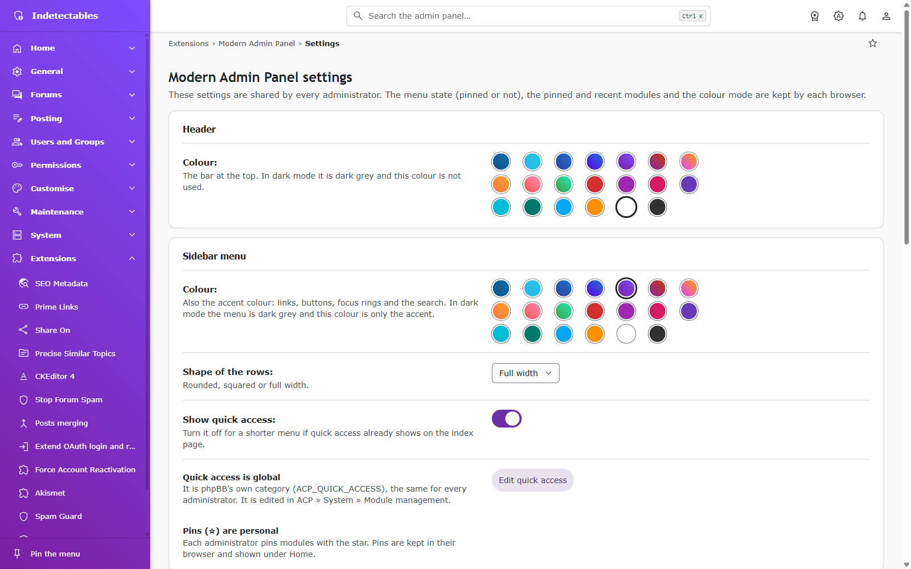

# Modern Admin Panel: user guide

This is the public, free edition of `dsr/modernadminpanel`, version 2.0.0.
It adds responsive ACP navigation, favourites, command search, themes, and
dashboard widgets. All documented panel features are included.

See [overview](../README.md), [features](FEATURES.md), [integration notes](EVENTS.txt),
[icon coverage](menu-extension-icons.md), and [changelog](CHANGELOG.md).
Runtime paths refer to repository `dsr/modernadminpanel/` or installed
`ext/dsr/modernadminpanel/`.

## Requirements

- phpBB 3.3.x, tested on 3.3.19. Metadata permits 4.0.x; compatibility is unverified.
- PHP 7.1.3 or later, subject to phpBB's requirements. phpBB 4.x requires PHP 8.2 or later.
- JavaScript for interactive features. Without it, a plain menu and settings search remain available.

## Install

1. Back up the board.
2. Extract the release ZIP into `ext/`, or copy repository `dsr/modernadminpanel/`
   there. Check the path: `ext/dsr/modernadminpanel/composer.json`.
3. Enable **Modern Admin Panel** under **Customise → Extension management → Manage extensions**.
4. Configure **Extensions → Modern Admin Panel → Settings**.

CSS and JavaScript are ready to use. No npm or compilation is required.
Enabling adds `admin_dashboard_*` settings, a welcome admin note, and two ACP
modules. It creates no additional database table.

### Configure the appearance

Choose header/sidebar colours, menu shape, search groups, and dashboard widgets.
Colour mode and favourites stay in each administrator's browser.

## Update

phpBB checks `last_ext_version.json` over HTTPS. The feed and downloads must be
public; no GitHub token is required. Updates are detected, not installed automatically.

1. Back up the board and read the release notes.
2. Disable **Modern Admin Panel**. **Do not select Delete data.**
3. Replace `ext/dsr/modernadminpanel/` with the new release.
4. Enable the extension to apply pending migrations.
5. Purge phpBB's cache and reload the ACP; clear stale browser assets if needed.

Replacing files does not rerun the initial migration. Future data changes require new migrations.

## Replace phpbbstudio/admindashboard

This is a separate extension, not an upgrade. Its enable check prevents both ACP shells running together.

1. Back up the board and copy any admin notes you need.
2. Disable `phpbbstudio/admindashboard`. If removing it, use its own **Delete data**
   operation separately; this deletes its settings and notes.
3. Install and enable **Modern Admin Panel**, then purge phpBB's cache.
4. After handling the old data, remove only `ext/phpbbstudio/admindashboard/`, not its vendor directory.

Browser preferences migrate once from `phpbbstudio.ad.` to `dsr.ad.`.
Database settings and notes are not imported.

## Uninstall

Disable the extension to retain settings. For permanent removal, select
**Delete data**, then remove its directory. This deletes its ACP modules,
`admin_dashboard_*` settings, and admin notes. Browser preferences remain in local storage.
Never use Delete data for a normal update.

## Privacy and security

- Shared settings and notes live in phpBB's database. Changes require `a_board`,
  a valid CSRF token, and create an administrator-log entry.
- Palette searches use the board's own ACP endpoint and enforce permissions.
  Results contain titles/names and links, not passwords, emails, IPs, or setting values.
- Styles, scripts, and icons are bundled; no CDN is required.

| localStorage key | Value |
| --- | --- |
| `dsr.ad.sidebar` | `expanded` or `collapsed` |
| `dsr.ad.theme` | `system`, `light`, or `dark` |
| `dsr.ad.u<ID>.recent` | Up to 8 recent module keys |
| `dsr.ad.u<ID>.pins` | Up to 12 favourite module keys |

`<ID>` identifies the administrator. Recent modules and favourites store keys,
not session-bearing URLs. The page-bar star adds favourites under **Home**.
phpBB's **Quick access** category is separate and shared.

The optional paid-module dialog locks no panel feature. Its contact button opens
your mail client after a click; it sends nothing automatically. The address is
lightly encoded, not encrypted.

## Paid modules and custom work

OAuth Register, Spam Guard, Async Notifications, Push Notifications, Android/iOS
apps, and custom extensions are offered separately. See the
[module list and contact](../README.md#paid-modules-and-custom-work), or email
[xchwarze@gmail.com](mailto:xchwarze@gmail.com) for availability and pricing.

## Translations

English (`en`) and Spanish (`es`) are included. To add a language, copy
`language/en/info_acp_dashboard.php` into `language/<iso>/`; translate values and preserve placeholders.

## Repository contents

- `dsr/modernadminpanel/`: installable runtime and licences.
- `docs/`: guides, screenshots, and integration reference.
- `README.md`: overview, installation, and paid-module contact.
- `LICENSE`: GPL text, also included in the extension directory.

This public distribution needs no private authoring sources or asset build.

## Support

Use [GitHub Issues](https://github.com/xchwarze/phpbb-modern-admin-panel/issues)
for reproducible bugs. Include environment details and steps; redact credentials,
session URLs, and private data. Report security-sensitive issues privately to the maintainer.

## Credits and licence

- Maintainer: DSR! ([xchwarze](https://github.com/xchwarze)).
- Based on phpBB Studio's Admin Dashboard 1.1.0 by phpBB Studio, 3Di, and mrgoldy.
  Original contributions include RTL by meis2m and settings search by kasimi.
  Existing code copyright notices remain.
- Google Material Symbols retain their [Apache-2.0 notices](../dsr/modernadminpanel/adm/style/images/ICONS-LICENSE.txt).
- Modern Admin Panel is licensed under [GNU GPL version 2 only](../LICENSE).
